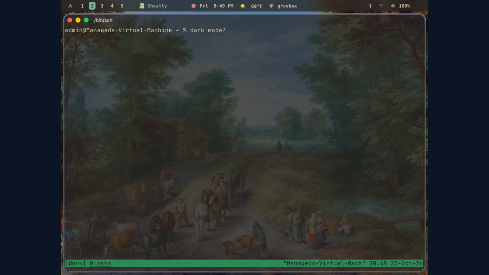
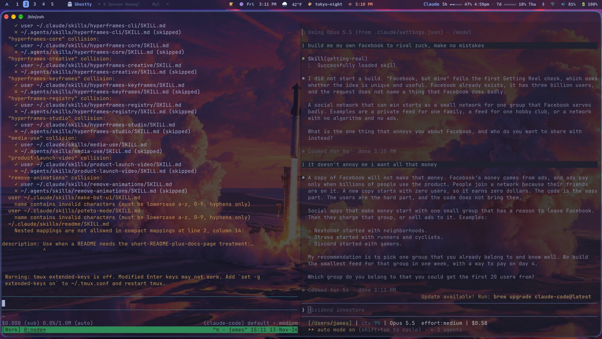

# omarchy4mac

Omarchy 4, for the Mac: AeroSpace tiles the windows, SketchyBar takes the bar,
and one script themes the terminal, the editor, the bar and the wallpaper at
once. The full documentation is at https://omarchy4mac.dividendsolo.com





## Install

```sh
curl -fsSL https://raw.githubusercontent.com/dividendsolo/omarchy4mac/main/install.sh | bash
```

Run the same command to update. It asks for Accessibility for AeroSpace and
Hammerspoon once, and opens the settings pane for it.

## What you get

- Tiling windows with Omarchy's keybinding vocabulary: five workspaces per
  monitor, focus, move, swap, resize, fullscreen, floating (⌥K lists them all).
- Omarchy's bar in SketchyBar: workspaces, clock, weather, Friday sunset, the
  update badge, the coding-agent limits, and widgets you can drag off.
- Every Omarchy v4 theme from one script, reaching Ghostty, Neovim, btop, the
  bar, the wallpaper, Claude Code, Obsidian and Hermes; ⌥T shuffles within the
  system's light or dark bucket, and the system flip re-themes everything.
- The menu tree on ⌘⇧Space, web apps as app windows, the herdr layouts, the
  `omarchy-*` commands, a ttfx screensaver, video backgrounds, theme intros.

## Documentation

The docs page carries the rest: the install steps and every option, all the
keybindings and shell aliases, the theme pipeline and the wallpapers, uninstall,
troubleshooting, the changelog, and the score against Omarchy v4.5.0 (75%).

https://omarchy4mac.dividendsolo.com

A search brought you here? The docs has a page for each of these:
[tiling window manager for a Mac](https://omarchy4mac.dividendsolo.com/docs/tiling-window-manager-mac),
[AeroSpace config](https://omarchy4mac.dividendsolo.com/docs/aerospace-config),
[SketchyBar config](https://omarchy4mac.dividendsolo.com/docs/sketchybar-config),
[Hyprland on a Mac](https://omarchy4mac.dividendsolo.com/docs/hyprland-on-mac),
[mac rice](https://omarchy4mac.dividendsolo.com/docs/mac-rice).

MIT. The reference for every behaviour is
[omacom/omarchy](https://github.com/omacom/omarchy).

I build AI droids for your GitHub repo: fixed price, fixed date, from $500,
live in 1 to 2 weeks. If you want one built, see
https://dividendsolo.com/work-with-me?utm_source=github&utm_medium=readme&utm_campaign=omarchy4mac
